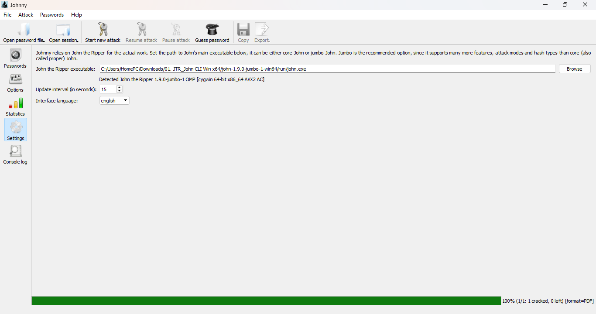
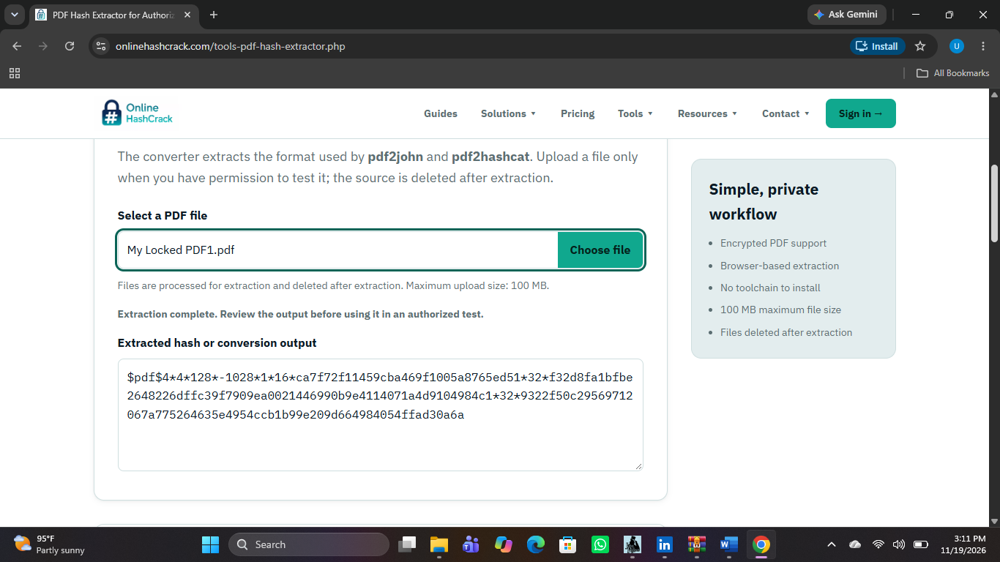
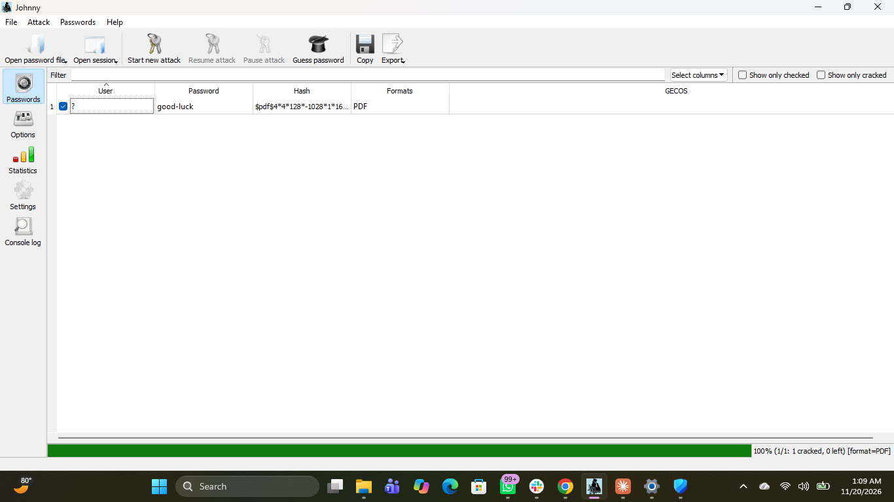
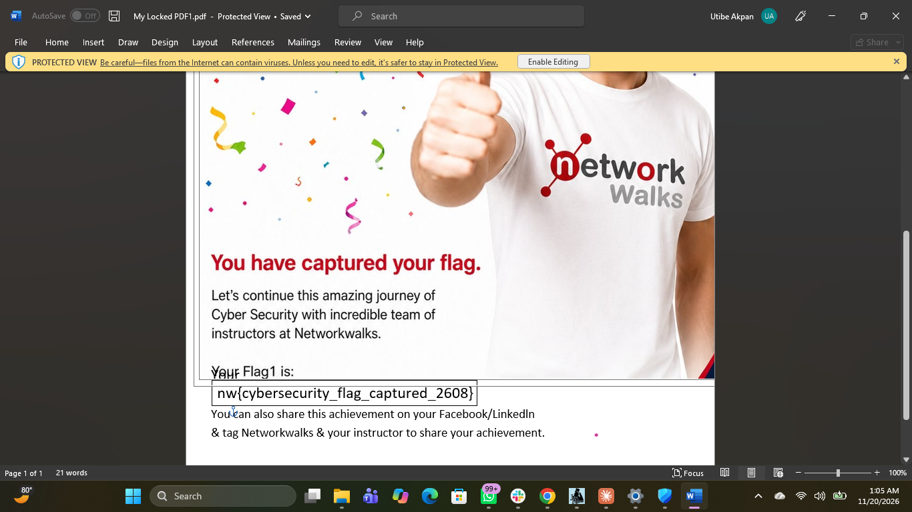
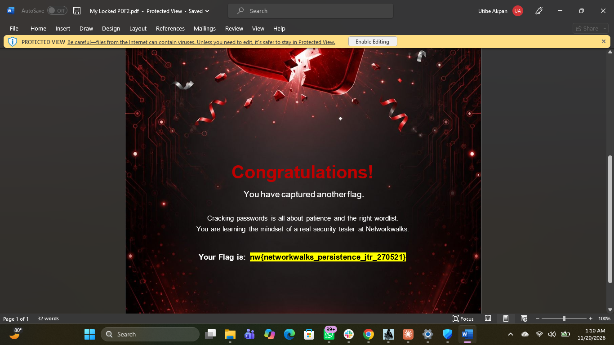
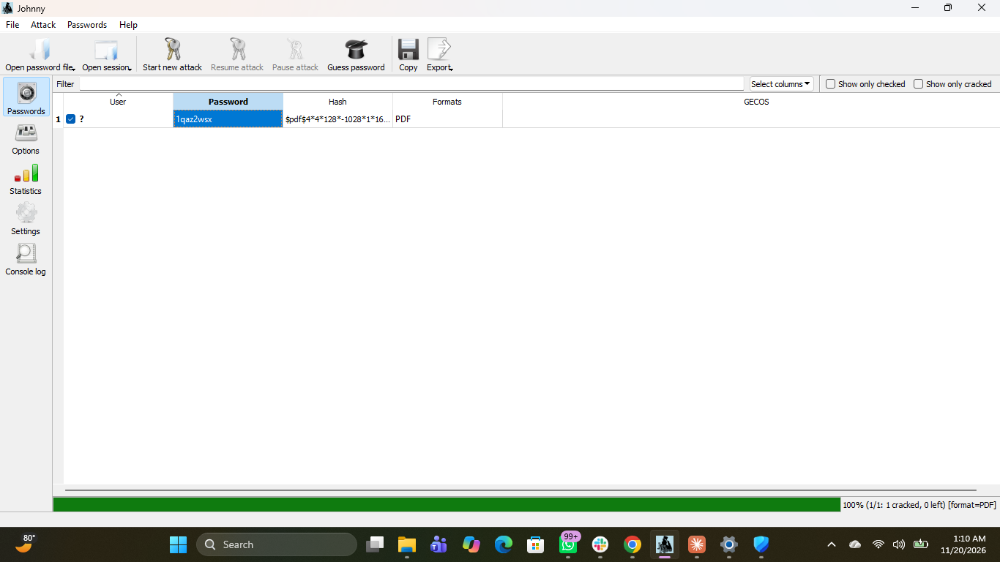
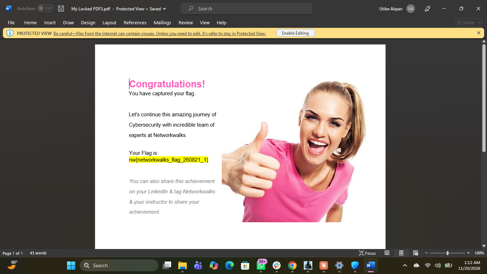
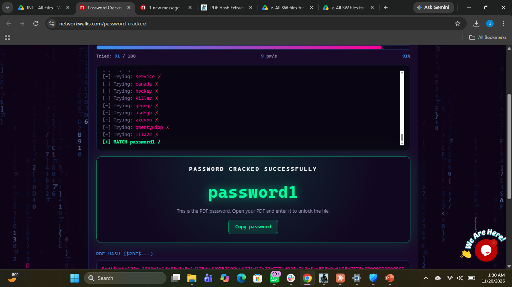
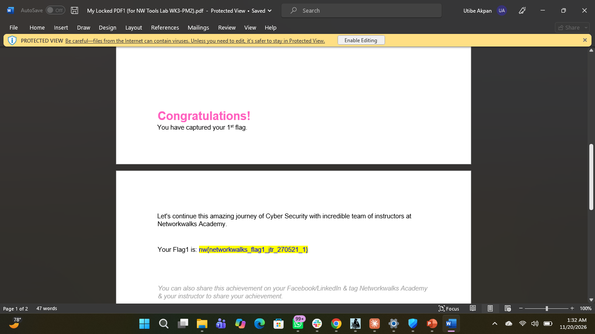

# Password Cracking with John the Ripper and Networkwalks Tools

## Overview
This project covers two password cracking exercises assigned during Week 3 of the
Networkwalks Cybersecurity & Ethical Hacking training. Both exercises target
password-protected PDF files and recover the password using a hash extraction
and dictionary attack workflow.

## Objective
Demonstrate the ability to extract a password hash from a protected file and
recover the original password using both a standalone cracking tool (John the
Ripper) and a browser-based cracking tool built by Networkwalks.

## Tools Used
- John the Ripper (John + Johnny GUI)
- Online Hash Crack (PDF hash extractor)
- Networkwalks Hash Calculator
- Networkwalks Password Cracker
- Microsoft Word (to open and verify the unlocked PDFs)

## Module 1: Password Cracking with JTR (John + Johnny)

### Step 1: Set up John the Ripper in Johnny
Downloaded John the Ripper and the Johnny GUI from the official Openwall
sources and pointed Johnny to the executable.

*Screenshot showing Johnny settings with the John the Ripper executable path configured and detected after extracting the zip file.*

### Step 2: Extract the password hash for PDF1
Uploaded the locked PDF to an online PDF hash extractor to generate the
`$pdf$...` hash.

*Screenshot showing the Online Hash Crack tool with the hash extracted from My Locked PDF1.pdf.*

### Step 3: Crack the password for PDF1
Loaded the hash into Johnny and ran the attack. The password was recovered.

*Screenshot showing Johnny's Passwords tab with the cracked password for My Locked PDF1.pdf.*

### Step 4: Confirm the PDF1 flag
Opened the PDF with the recovered password and confirmed the captured flag.

*Screenshot showing My Locked PDF1.pdf opened in Word with the captured flag visible.*

### Step 5: Confirm the PDF2 flag
Repeated the full workflow against a second locked PDF and confirmed the
captured flag. The password-crack step for this file was not captured as a
separate screenshot, but the end result confirms the same process succeeded.

*Screenshot showing My Locked PDF2.pdf opened with the captured flag visible.*

### Step 6: Crack the password for PDF3
Ran the same workflow against a third locked PDF to confirm it holds
against a different password hash.

*Screenshot showing Johnny's Passwords tab with the cracked password for My Locked PDF3.pdf.*

### Step 7: Confirm the PDF3 flag
Opened the PDF with the recovered password and confirmed the captured flag.

*Screenshot showing My Locked PDF3.pdf opened with the captured flag visible.*

### Issue Encountered and Fix
Johnny could not locate john.exe after the initial download. The cause was
that the zip file had not been extracted. Windows allows browsing inside a
zip file without fully extracting it, which made the folder appear present
but empty. Extracting the zip to a standalone folder resolved the issue, and
Johnny correctly detected john.exe once pointed to the `run` subfolder.

## Module 2: Password Cracking with Networkwalks Tools

### Step 1: Extract the hash and run the Password Cracker
Extracted the hash using the Networkwalks Hash Calculator, pasted it into
the Networkwalks Password Cracker, and ran the dictionary attack using the
built-in wordlist.

*Screenshot showing the Networkwalks Password Cracker with the password cracked successfully.*

### Step 2: Confirm the flag
Opened the PDF with the recovered password and confirmed the captured flag.

*Screenshot showing the cracked PDF from the Networkwalks Tools lab opened with the captured flag visible.*

## Key Takeaway
Both exercises recovered the password from a protected PDF within seconds
using a basic dictionary attack. This confirms a point every security team
should internalize. A password like "password1" offers no real protection
against even entry-level cracking tools. Strong, unique passwords and
proper file encryption remain the baseline defense against this kind of
attack, not the exception.

## Disclaimer
This project was carried out in a controlled training environment using
files provided for educational purposes. The techniques shown here should
only be applied to systems and files you own or have explicit written
authorization to test.
